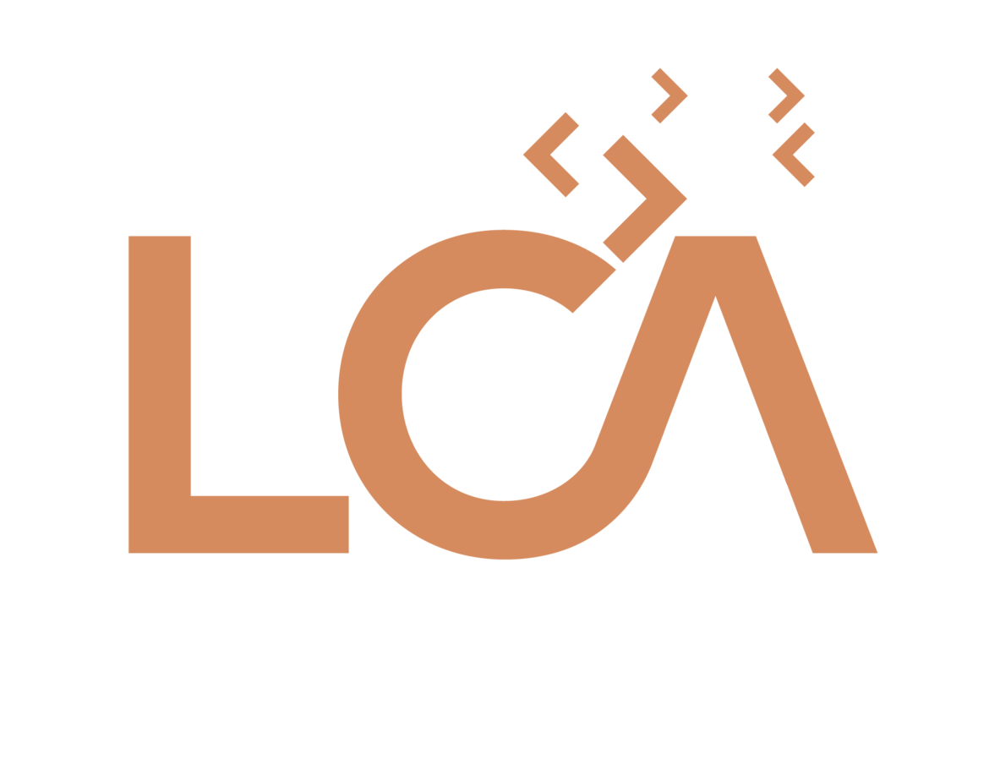
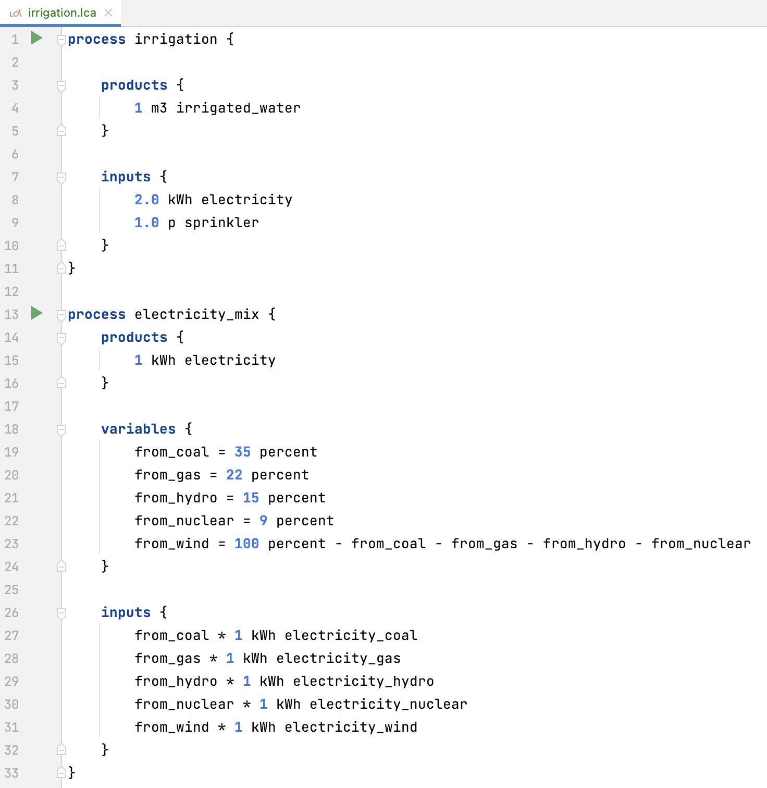

# LCA as Code


This is the official repository of LCA as Code language.

## What is LCA as Code?

LCA as Code is a domain-specific language (DSL) for life-cycle analysis experts.
Its *declarative* approach allows to define *parametrized* and *reusable* LCA models.
See our [book](https://lca-as-code.com/book) to learn more about the language.



## Table of Contents

1. [Getting started](#getting-started)
2. [What's inside](#whats-inside)
3. [Documentation](#documentation)
4. [Related projects](#related-projects)
5. [License](#license)
6. [About us](#about-us)

## Getting started

### Install

From the source
```bash
git checkout v3.2.0
./gradlew :cli:installDist
alias lcaac=$GIT_ROOT/cli/build/install/lcaac/bin/lcaac
lcaac version
```

From Homebrew
```bash
brew tap kleis-technology/lcaac
brew install lcaac-cli
lcaac version
```

### Impact assessment

Check the sample file in `$GIT_ROOT/cli/samples/main.lca`.

```lca
process electricity_mix {
    params {
        from_fossil = 40 percent
        from_nuclear = 20 percent
        from_hydro = 40 percent
    }
    products {
        1 kWh electricity
    }
    inputs {
        from_fossil * 1 kWh electricity from fossil
        from_nuclear * 1 kWh electricity from nuclear
        from_hydro * 1 kWh electricity from hydro
    }
}
// rest of the file omitted
```


Now you can assess the process `electricity_mix`.
```bash
cd $GIT_ROOT/cli/samples
lcaac assess "electricity_mix"
```
The result is printed on the standard output in tabular format.
```
product      amount  reference unit  co2  co2_unit
-----------  ------  --------------  ---  --------
electricity  1.0     kWh             5.4  kg
```

Use `-o csv` or `-o json` for machine-readable output, and `-i <indicator>` to filter the indicators shown.
```bash
lcaac assess "electricity_mix" -o csv
lcaac assess "electricity_mix" -o json -i co2
```

You can also run multiple assessments with an external data csv file providing values for the process parameters.
```bash
lcaac assess "electricity_mix" --file params.csv
```

### Explain

The `explain` command shows how the impacts of a process are obtained, step by step: the parameters,
variables and data source reads of each process of the supply chain, and how the impact per unit of
each product is obtained from its exchanges, checked against the solver.

```bash
cd $GIT_ROOT/cli/samples
lcaac explain "electricity_mix"
```

See the tutorial [Explaining a result](tutorials/03-advanced/05-explain/README.md) to read its output.

### Graph

The `graph` command renders the process supply chain as a [Mermaid](https://mermaid.js.org) flowchart.

```bash
cd $GIT_ROOT/cli/samples
lcaac graph "electricity_mix"
```

```
flowchart BT
    classDef invisible fill:none,stroke:none
    ep0[ ]:::invisible
    prod0["electricity_mix"]
    prod1["fossil"]
    prod2["nuclear"]
    prod3["hydro"]
    prod0 -->|"electricity"| ep0
    prod1 -->|"electricity"| prod0
    prod2 -->|"electricity"| prod0
    prod3 -->|"electricity"| prod0
```

Use `-o html` to get a self-contained HTML page with the graph rendered in the browser.
```bash
lcaac graph "electricity_mix" -o html > graph.html
```

Use `-i <indicator>` to display each process's contribution to an indicator on the edges.
By default, the contribution is shown as a percentage; use `--absolute` for absolute values.
```bash
lcaac graph "electricity_mix" -i co2
lcaac graph "electricity_mix" -i co2 --absolute
```

Additional display options: `--show-biosphere`, `--show-impacts`, `--show-quantities`, `--hide-products`.

### Tests

The language allows to define tests as well. See the file `$GIT_ROOT/cli/samples/test.lca`.

```lca
test should_pass {
    given {
        1 kWh electricity from electricity_mix
    }
    assert {
        co2 between 0 kg and 10 kg
    }
}
// rest of the file omitted
```

Run the tests using
```bash
lcaac test --show-success
```

### Serve

The `serve` command serves a model as an HTTP API. The API is declared under the key `api` of `lcaac.yaml`: each
operation maps the fields of a JSON request onto the parameters of a process, and returns selected results.

```yaml
api:
  name: electricity
  version: 1.0.0
  units:
    impacts: { co2: kg }
  operations:
    electricity_mix:
      process: electricity_mix
      inputs:
        fossil: { parameter: from_fossil }
        nuclear: { parameter: from_nuclear }
        hydro: { parameter: from_hydro }
      outputs:
        impacts: { select: [co2], where: { process: electricity_mix }, aggregate: one }
```

The definition is checked against the model at startup. Then each operation is served at `POST /<operation>`,
and at `POST /<operation>/batch` for several requests at once.
```bash
lcaac serve
curl -X POST localhost:8080/electricity_mix -H 'Content-Type: application/json' \
  -d '{"fossil": "10 percent", "hydro": "70 percent"}'
```
```json
{"request":{"fossil":"10 percent","hydro":"70 percent"},"outputs":{"impacts":{"co2":{"amount":2.7,"unit":"kg"}}}}
```

`lcaac api openapi` prints the OpenAPI document of the API. See the tutorial
[Serving a model as an HTTP API](tutorials/03-advanced/06-serve/README.md) for the whole definition: data sources
given by requests, one result per row, global parameters, units.

### Agent skills

lcaac ships [agent skills](https://agentskills.io), to help AI agents write models and use the CLI:
`lcaac-modeling` (the language, modeling patterns, pitfalls) and `lcaac-cli` (the commands, `lcaac.yaml`,
`lcaac serve`). Install them into your project, where agents that support skills will find them.
```bash
lcaac skills install                         # into .agents/skills
lcaac skills install --user                  # into ~/.agents/skills, for all your projects
lcaac skills install --dir .claude/skills    # for an agent with its own directory, here Claude Code
```

The skills installed match the version of lcaac. See [skills](skills/README.md) to develop and evaluate them.

## What's inside

This repository contains the core libraries to handle LCAAC code.

### Package `core`

The package `core` contains:
- the language's abstract syntax tree (AST)
- the evaluator
- analysis programs, namely, contribution analysis, and local sensitivity analysis

### Package `grammar`

The package `grammar` contains:
- a concrete ANTLR-based grammar
- utilities to parse and load LCAAC files.

### Package `cli`

The package `cli` contains the code for the command-line interface.

### Package `server`

The package `server` contains the HTTP server of `lcaac serve`: the API definition, its checks, and the OpenAPI
document.

### Skills

The directory `skills` contains the agent skills bundled with the CLI, and their evaluations.

## Documentation

For users
- [Walkthrough](https://lca-as-code.com/book)
- [Code samples](./tutorials/README.md)
- [Serving a model as an HTTP API](./tutorials/03-advanced/06-serve/README.md)

For developers
- [Release management](./RELEASE-MANAGEMENT.md)
- [Agent skills](./skills/README.md)
- Core concepts *\[coming soon\]*
- Contribution guide *\[coming soon\]*

## Related projects

### Cloud Assess


[Cloud Assess](https://github.com/kleis-technology/cloud-assess) is an open-source tool 
to automate the assessment of the environmental impacts of cloud services.
It aims at defining a *trusted library* of LCA models, written in the LCAAC language,
which can be easily consulted via a REST API.

### LCA as Code IDE



An integrated-development environment (IDE) is [available](https://lca-as-code.com).
This editor provides facilities to develop and interact with LCAAC models. E.g.
- Automatic unit consistency check with syntax highlighting.
- Integrated analysis and visualization.
- Support for collaboration and code review.

## License

This work is dual licensed (see [LICENSE](LICENSE.txt)):
- AGPL v3
- or commercial license. 
Reach out to `contact@kleis.ch` for more information.

## About us


We are [Kleis Technology](https://kleis.ch).
Software craftsmen, thirsty for knowledge, with experience in complex subjects, we solve challenges in a pragmatic manner. 
Backed by our core values of trust, commitment and continuous improvement, we love to make and create.
